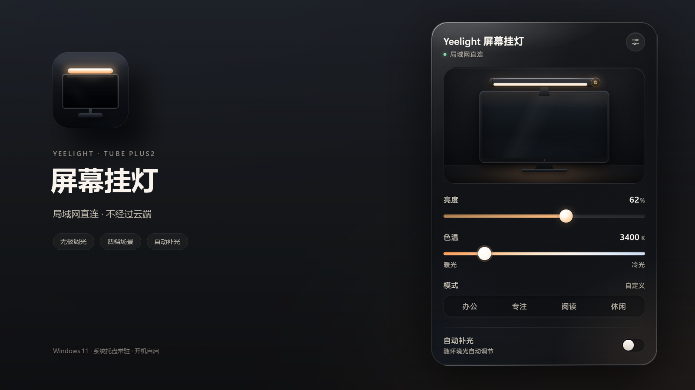
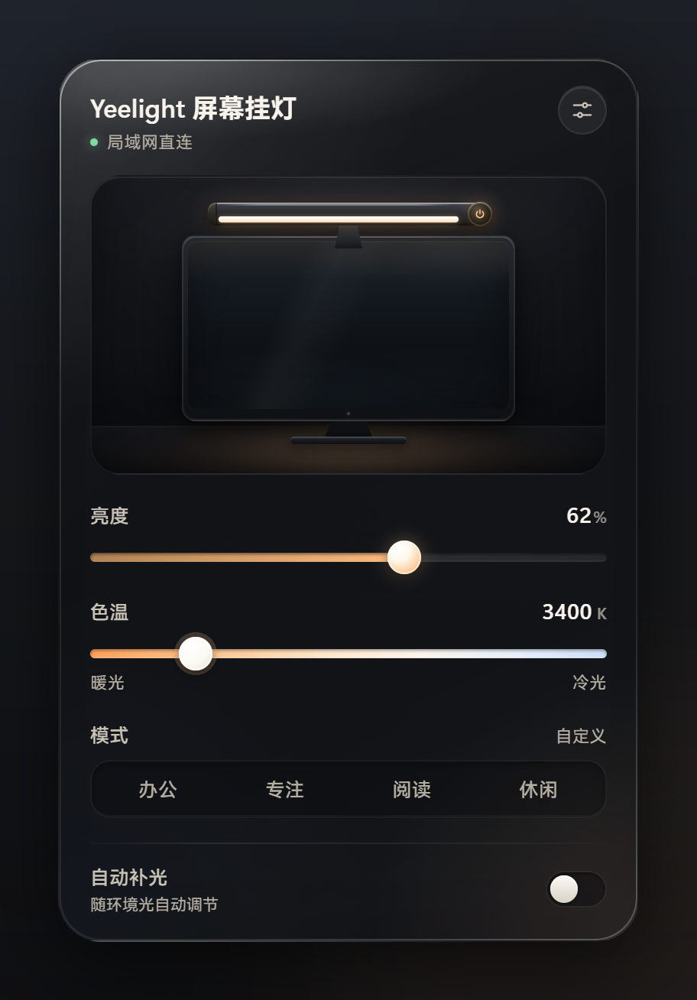
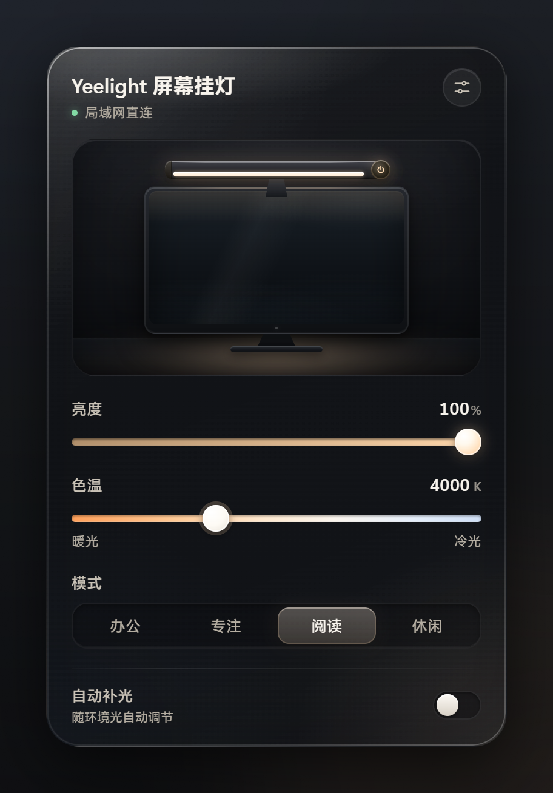
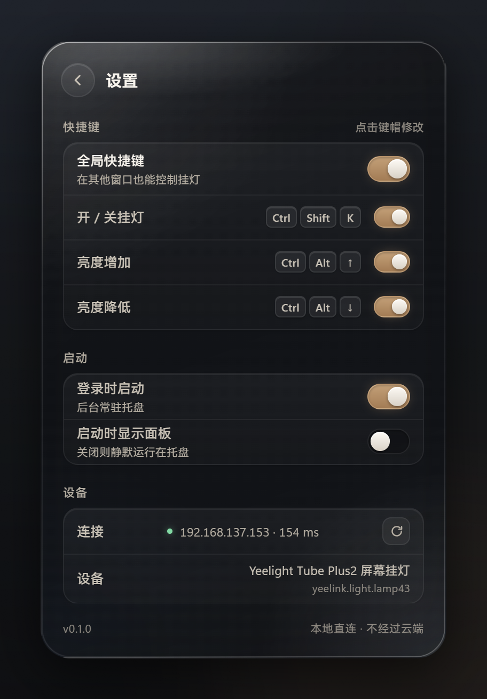
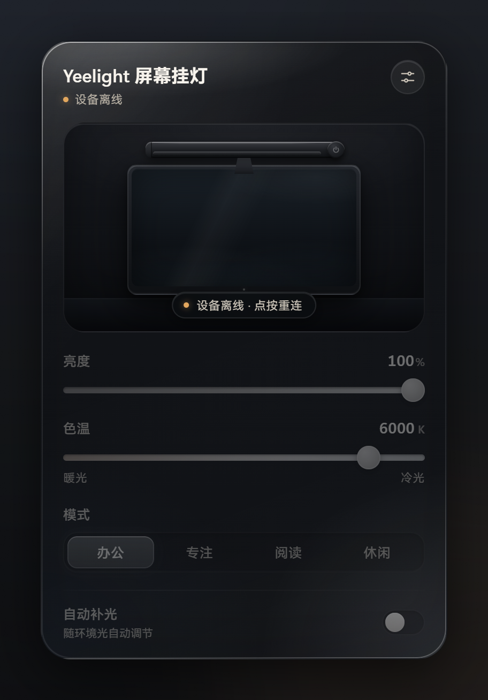
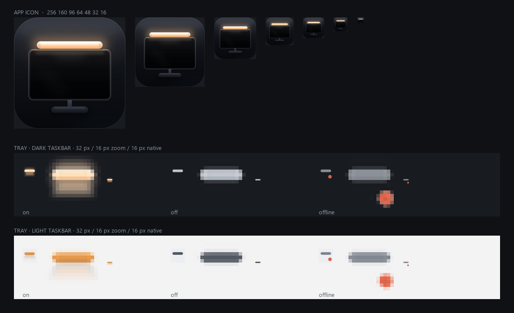

<p align="center">
  
</p>

<h1 align="center">Yeelight 屏幕挂灯</h1>

<p align="center">
  为 <b>Yeelight 智能屏幕挂灯 2（Tube Plus2）</b> 打造的 Windows 托盘应用<br>
  局域网直连 · 不经过云端 · 断网也能用
</p>

<p align="center">
  
  
  
  
</p>



点一下托盘图标，弹出玻璃面板：开关、亮度、色温、场景和自动补光都在这里。
所有指令通过局域网 miIO 协议（UDP 54321，AES 加密）直达灯体，不经过 Yeelight 云，也不依赖互联网。

## 亮点

| 能力 | 说明 |
|---|---|
| **本地直连** | 与灯体直接通信，局域网内响应通常在 0.3 秒左右；断网也能正常控制 |
| **顺滑调光** | 亮度 1–100%、色温 2700–6500K，拖动即时写入；关灯时调节会先开灯再写值 |
| **四档场景** | 办公 / 专注 / 阅读 / 休闲，一键切换；手动调节后自动回到「自定义」 |
| **自动补光** | 交给灯体按环境光调节，开启后回读真实亮度与色温 |
| **托盘三态** | 开灯 / 关灯 / 离线三种图标，跟随深色、浅色任务栏自动切换 |
| **全局快捷键** | 开关灯与亮度 ±，共 3 组；默认关闭，可逐条启用、随意改键 |
| **安静常驻** | 单实例、开机自启、断线自动重连、设备换 IP 自动发现 |
| **原生质感** | Rust + Tauri 2，安装包约 2.5 MB；界面手写 HTML / CSS，无前端框架 |

## 界面

<p align="center">
  
  
</p>
<p align="center">
  
  
</p>

面板不是系统控件的拼装：玻璃层次、随灯色温渲染的暖光、滑杆与开关的按压反馈都单独绘制；
托盘图标也按深色、浅色任务栏各准备了一套。

<p align="center">
  
</p>

## 场景与自动补光

| 场景 | 亮度 | 色温 |
|---|---:|---:|
| 办公 | 100% | 6000K |
| 专注 | 80% | 5000K |
| 阅读 | 100% | 4000K |
| 休闲 | 30% | 2700K |

点选场景后，亮度与色温按上表写入灯体。之后只要手动拖动亮度、色温或用快捷键调节，模式就会回到「自定义」。

自动补光开启后，亮度和色温交由灯体根据环境光决定，面板会回读并显示真实数值。
此时手动调节亮度、色温或点选场景，会自动退出补光并采用你的设置；重新打开开关即可再次交给灯体。

## 快捷键

| 动作 | 默认组合键 |
|---|---|
| 开 / 关挂灯 | `Ctrl` + `Alt` + `L` |
| 亮度增加 | `Ctrl` + `Alt` + `↑` |
| 亮度降低 | `Ctrl` + `Alt` + `↓` |

全局快捷键总开关默认关闭，避免与其它软件冲突。可在「设置」中打开总开关，再逐条启用或点击键帽重新录制。

## 安装

支持 Windows 10 / 11，需要 WebView2 运行时（Windows 11 已自带）。

从仓库的 Releases 页面下载：

| 文件 | 说明 |
|---|---|
| `yeelight-lamp_0.1.0_x64-setup.exe` | 推荐；当前用户安装，无需管理员权限，装完自动驻留托盘 |
| `yeelight-lamp_0.1.0_x64-portable.zip` | 免安装；解压后运行 `yeelight-lamp.exe` |
| `SHA256SUMS.txt` | 安装包与便携包的 SHA-256 校验和 |

> 目前仅适配 `yeelink.light.lamp43`（Yeelight 智能屏幕挂灯 2 / Tube Plus2）。
> 其它型号的 siid / piid 可能不同，需要自行调整协议参数。

### 从源码构建

前置：Rust stable（MSVC）、Visual Studio C++ 生成工具、Node.js 20+。

```powershell
npm install
npm run tauri build
```

产物：

- 安装包 `src-tauri/target/release/bundle/nsis/Yeelight 屏幕挂灯_0.1.0_x64-setup.exe`
- 可执行文件 `src-tauri/target/release/yeelight-lamp.exe`

生成发布资产（ASCII 命名的安装包、免安装 ZIP 与校验和）：

```powershell
powershell -ExecutionPolicy Bypass -File tools\package_release.ps1
```

文件会输出到 `src-tauri/target/release/release-assets/`。

## 首次连接

挂灯只支持 2.4GHz 的普通 WPA2 / WPA3 网络，无法通过校园网或企业网的 802.1X 认证。
推荐让电脑开一个 2.4GHz 移动热点专门给灯用，电脑本身继续连接原来的 Wi-Fi。

1. 打开「设置 → 网络和 Internet → 移动热点」，频段选 2.4GHz，打开热点
2. 挂灯上电，等待它自动连上热点
3. 启动程序，点击托盘图标开始控制

> 热点没有外网也可以，灯只需要和电脑处在同一局域网。

首次使用或更换设备后，需要把设备 token 写入本机：

```powershell
cd tools\py
py -3.12 -m venv .venv
.venv\Scripts\python -m pip install -r requirements.txt
.venv\Scripts\python get_token.py --login
```

按提示在浏览器完成小米账号登录。脚本只把设备 token 写入
`%APPDATA%\yeelight-lamp\config.json`，不会打印完整凭据，也不会上传。

## 常见问题

**托盘里找不到图标？**
Windows 11 会把新图标折叠进任务栏的 `^` 溢出区，把它拖到任务栏上即可常驻。

**提示「局域网内找不到灯」？**
确认热点为 2.4GHz、挂灯已上电，并且电脑与灯在同一网段；路由器或热点开启 AP 隔离时也会失败。
可在「设置 → 设备 → 连接」点刷新重试。

**换了网络或设备？**
重新运行 `get_token.py --login` 覆盖本机 token；程序会自动发现新的 IP。

**快捷键没有反应？**
全局快捷键默认关闭，请先在设置中打开总开关并确认对应条目已启用；
组合键与其它软件冲突时，点击键帽重新录制。

**安装时提示「未知发布者」？**
当前安装包暂未做代码签名，SmartScreen 可能给出提示。
可在 Releases 中下载 `SHA256SUMS.txt` 核对安装包，再选择「更多信息 → 仍要运行」。

## 隐私

- 设备 token 仅保存在本机 `%APPDATA%\yeelight-lamp\config.json`，不进入仓库、不上传
- 日常运行只与局域网内的灯通信，不访问云端，也没有任何遥测
- 只有主动运行 `get_token.py --login` 时才会连接小米账号服务

## 架构

```text
yeelight-lamp/
├─ src-tauri/                 Rust 后端与打包配置
│  └─ src/                    miIO、设备、托盘、热键、设置、窗口
├─ ui/                        面板界面（手写 HTML / CSS / JS）
├─ tools/
│  ├─ py/                     设备 token 获取
│  ├─ gen_icons.py            应用图标与托盘图标
│  └─ gen_installer_art.py    安装器页眉与侧栏
├─ docs/                      协议笔记、截图、发布说明
├─ design/                    视觉稿与图标预览
└─ README.md
```

| 模块 | 职责 |
|---|---|
| `miio.rs` | miIO 握手、AES-128-CBC 加解密、UDP 广播发现 |
| `device.rs` | 灯体能力封装：开关、亮度、色温、场景、自动补光 |
| `app.rs` | 托盘菜单、状态轮询、命令分发与单实例 |
| `settings.rs` | 快捷键、自启动等设置读写 |
| `ui/index.html` | 玻璃面板、设置页、快捷键录制与防抖写入 |

设备协议、实测行为与 token 获取方式见 [`docs/protocol.md`](docs/protocol.md)。

## 开发

```powershell
npm install
npm run tauri dev
```

前端是静态文件，`tauri.conf.json` 的 `frontendDist` 直接指向 `ui/`，不使用打包器。
界面资源在构建时嵌入可执行文件，修改后需要重启 dev 进程或重新构建才能生效。

## 版本

当前版本 **v0.1.0**，更新记录见 [`CHANGELOG.md`](CHANGELOG.md)。

---

本项目为个人开发的第三方工具，与 Yeelight 官方无关。「Yeelight」是其权利人的商标。
