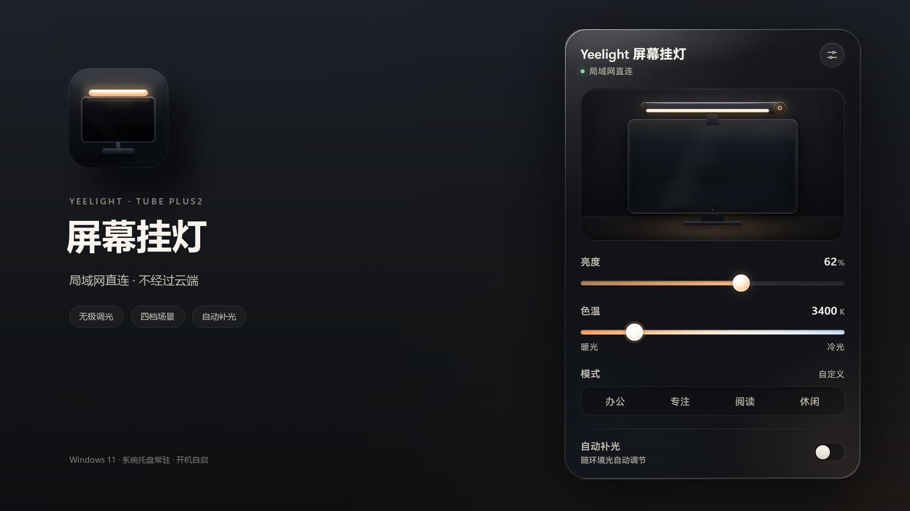

# Yeelight 屏幕挂灯 v0.1.3

后台轮询更安静：面板收起后大幅降低请求频率，网络抖动也不再触发全量重连。



## 下载

| 文件 | 大小 | 说明 |
| --- | ---: | --- |
| `yeelight-lamp_0.1.3_x64-setup.exe` | 2.49 MB | 推荐；当前用户安装，无需管理员权限 |
| `yeelight-lamp_0.1.3_x64-portable.zip` | 3.17 MB | 免安装，解压后运行 `yeelight-lamp.exe` |
| `SHA256SUMS.txt` | < 1 KB | SHA-256 校验和 |

系统要求：Windows 10 / 11，WebView2 运行时（Windows 11 已自带）。

## 本次更新

### 改进

- 自适应轮询：面板可见时 2.5 秒一次，收起到托盘后 20 秒一次；隐藏状态下的请求量约为原来的 1/8
- 打开面板时立即刷新状态，收起期间托盘数值最多滞后 20 秒
- 单次 UDP 丢包不再丢弃会话、触发 ARP / 广播的全量重连；连续失败 3 次才重新握手
- 离线重试加入 4 → 8 → 16 → 32 → 60 秒退避，挂灯断电时不再持续扫描局域网
- `lampctl raw` 输出会对 `token` 等敏感字段脱敏
- 新增轮询节奏单元测试，架构文档同步更新

## 安装

1. 下载并运行 `yeelight-lamp_0.1.3_x64-setup.exe`
2. 已安装 v0.1.2 的用户直接覆盖安装即可，本机设置与设备 token 会保留
3. 点击托盘图标打开面板

## 已知限制

- 仅适配 `yeelink.light.lamp43`（Yeelight 智能屏幕挂灯 2 / Tube Plus2）
- 挂灯仅支持 2.4GHz 的 WPA2 / WPA3 网络，不支持 802.1X
- 安装包暂未做代码签名，Windows SmartScreen 可能提示「未知发布者」；可核对下方 SHA-256 后继续

## 校验和

```text
74c18fd25aa232af6ab915a1d3fda2e80f2b69a7cd83089d907e92213a2fda95  yeelight-lamp_0.1.3_x64-portable.zip
267af1e4c12039bccc12c5e5499ac6971faad44efcfa387e06fbb0e6280f2891  yeelight-lamp_0.1.3_x64-setup.exe
```

## 许可证

本项目以 [MIT 许可证](https://github.com/Mornstic/yeelight-lamp/blob/main/LICENSE) 发布。与 Yeelight 官方无关，「Yeelight」是其权利人的商标。
