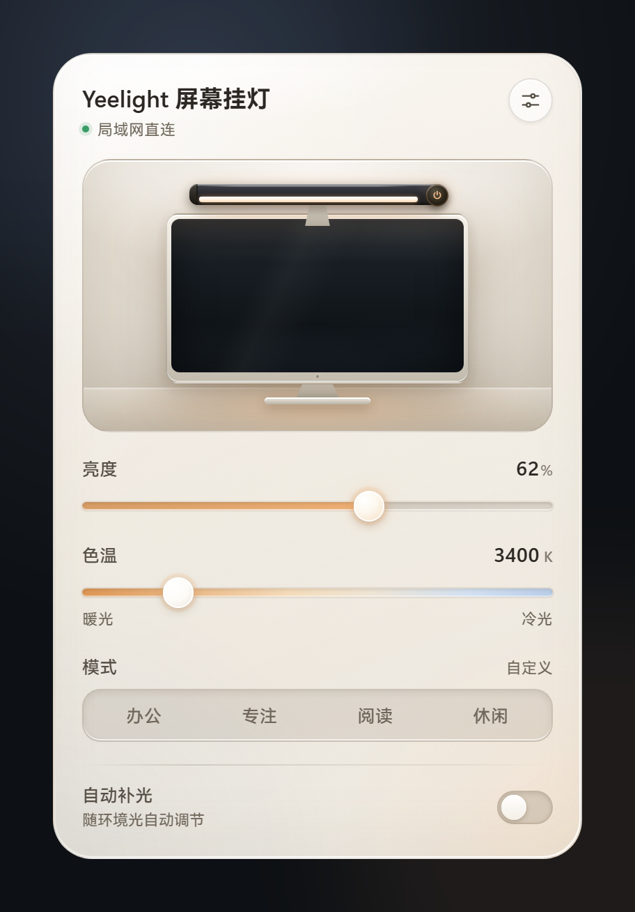
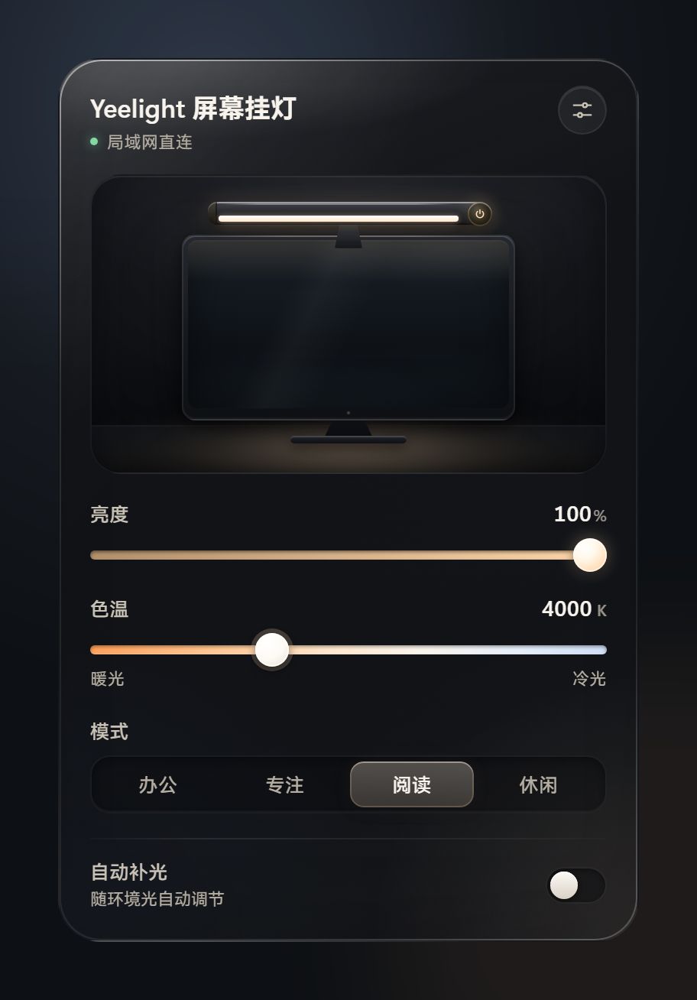

# Yeelight 屏幕挂灯 v0.2.0

面板现在会跟随 Windows 的深浅色设置：白天是暖白纸感、银灰机身，夜里回到深色玻璃。也可以在外观设置里固定浅色或深色。

<p align="center">
  
  
</p>

## 下载

| 文件 | 大小 | 说明 |
| --- | ---: | --- |
| `yeelight-lamp_0.2.0_x64-setup.exe` | 2.50 MB | 推荐；当前用户安装，无需管理员权限 |
| `yeelight-lamp_0.2.0_x64-portable.zip` | 3.19 MB | 免安装，解压后运行 `yeelight-lamp.exe` |
| `SHA256SUMS.txt` | < 1 KB | SHA-256 校验和 |

系统要求：Windows 10 / 11，WebView2 运行时（Windows 11 已自带）。

## 本次更新

### 新增

- 外观设置：跟随系统 / 浅色 / 深色，默认跟随 Windows 应用主题（`AppsUseLightTheme`）
- 浅色主题：暖白纸感玻璃、银灰机身与深色屏幕，琥珀光仍是唯一的强调色
- 主题切换带 260ms 交叉淡入，并尊重系统「减少动态效果」设置；系统主题变化后面板自动更新

### 改进

- 面板版本号改为运行时读取，不再写死在 HTML 中
- 设置页新增「外观」分组；内容超出时用渐隐提示可继续滚动
- 功能说明文字统一提升到 11px 下限，浅色下的滑杆、开关与状态点重新调过材质和边缘

## 安装

1. 下载并运行 `yeelight-lamp_0.2.0_x64-setup.exe`
2. 已安装 v0.1.x 的用户直接覆盖安装即可，本机设置与设备 token 会保留
3. 点击托盘图标打开面板；在「设置 → 外观」中可以固定浅色或深色

## 已知限制

- 仅适配 `yeelink.light.lamp43`（Yeelight 智能屏幕挂灯 2 / Tube Plus2）
- 挂灯仅支持 2.4GHz 的 WPA2 / WPA3 网络，不支持 802.1X
- 安装包暂未做代码签名，Windows SmartScreen 可能提示「未知发布者」；可核对下方 SHA-256 后继续

## 校验和

```text
6899f21ad0026fa72f865ee23d332b69675e485b2c8b16ff30e70748b37b8059  yeelight-lamp_0.2.0_x64-portable.zip
1b9d917a15502c7ac1302ae7a314a4037fbc62dd64c2152a618cf6b28dc04062  yeelight-lamp_0.2.0_x64-setup.exe
```

## 许可证

本项目以 [MIT 许可证](https://github.com/Mornstic/yeelight-lamp/blob/main/LICENSE) 发布。与 Yeelight 官方无关，「Yeelight」是其权利人的商标。
