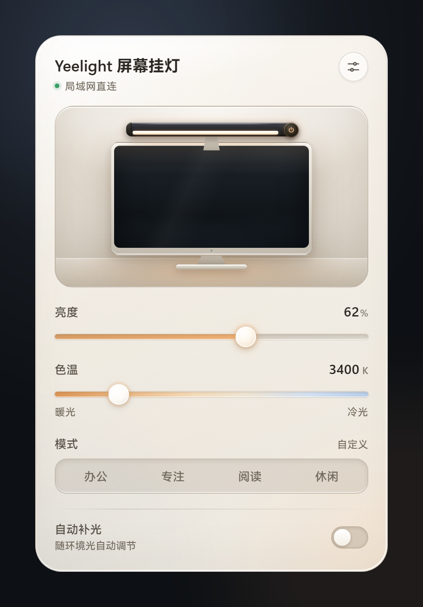

# Yeelight 屏幕挂灯 v0.2.1

这个版本只做一件事：让托盘里的挂灯真正“安静”下来。面板关闭后会释放整个 WebView2，后台只留一个十几 MB 的主进程；下次打开再按需重建，界面和功能没有变化。

<p align="center">
  
</p>

## 下载

| 文件 | 大小 | 说明 |
| --- | ---: | --- |
| `yeelight-lamp_0.2.1_x64-setup.exe` | 2.51 MB | 推荐；当前用户安装，无需管理员权限 |
| `yeelight-lamp_0.2.1_x64-portable.zip` | 3.19 MB | 免安装，解压后运行 `yeelight-lamp.exe` |
| `SHA256SUMS.txt` | < 1 KB | SHA-256 校验和 |

系统要求：Windows 10 / 11，WebView2 运行时（Windows 11 已自带）。

## 本次更新

### 改进

- 面板按需创建、关闭即销毁：收起面板后 WebView2 进程全部退出，实测后台工作集从约 470MB 降到约 15MB，CPU 保持 0%
- 再次打开时重建面板，并等快照、设置、主题都渲染完再显示，避免白闪和主题跳变；实测打开耗时约 0.3–0.5 秒
- 关闭按钮、点击面板外、Esc、托盘切换与再次启动程序唤出，都走同一套状态机；销毁面板后托盘、全局快捷键和后台轮询照常工作

### 工程

- `window.rs` 增加创建、首屏就绪、销毁的生命周期与兜底逻辑；最后一个窗口销毁时应用不再退出
- 架构文档补充窗口生命周期与前端就绪握手的说明

## 安装

1. 下载并运行 `yeelight-lamp_0.2.1_x64-setup.exe`
2. 已安装旧版本的用户直接覆盖安装即可，本机设置与设备 token 会保留
3. 点击托盘图标打开面板；关闭面板后程序仍驻留托盘

## 已知限制

- 仅适配 `yeelink.light.lamp43`（Yeelight 智能屏幕挂灯 2 / Tube Plus2）
- 挂灯仅支持 2.4GHz 的 WPA2 / WPA3 网络，不支持 802.1X
- 安装包暂未做代码签名，Windows SmartScreen 可能提示「未知发布者」；可核对下方 SHA-256 后继续

## 校验和

```text
e201a602e3203d8bb799eaf590932d5397cabbec4fbbaeebed322a9a79191372  yeelight-lamp_0.2.1_x64-portable.zip
dcdf6b069b2c96bd703d36568711052e5f032cd2853528949e6a19c57084725a  yeelight-lamp_0.2.1_x64-setup.exe
```

## 许可证

本项目以 [MIT 许可证](https://github.com/Mornstic/yeelight-lamp/blob/main/LICENSE) 发布。与 Yeelight 官方无关，「Yeelight」是其权利人的商标。
