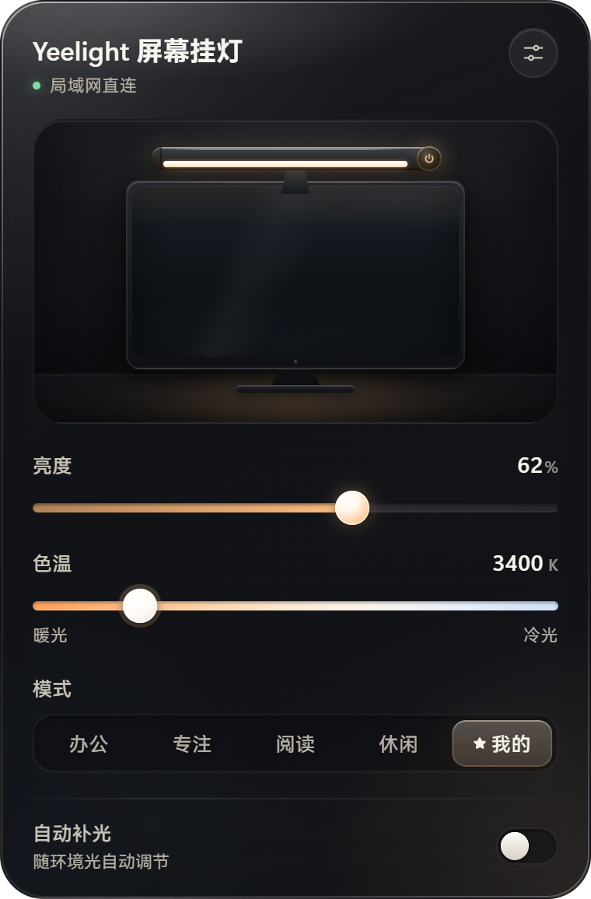
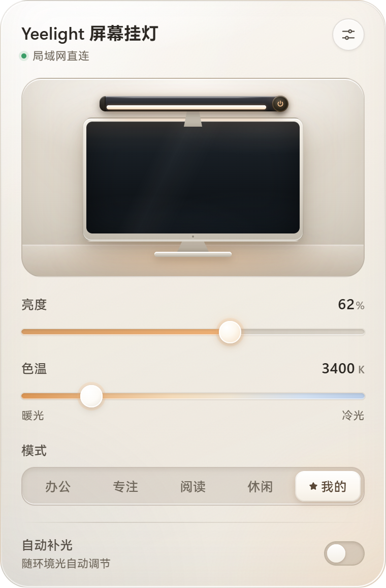

# Yeelight 屏幕挂灯 v0.2.4

四个厂家模式之外，现在可以保存一个自己的「我的模式」：调好亮度、色温后长按「我的」就存下来，之后点一下即可回到这个状态。没有多级菜单，也不占额外空间。

<p align="center">
  
  
</p>

## 下载

| 文件 | 大小 | 说明 |
| --- | ---: | --- |
| `yeelight-lamp_0.2.4_x64-setup.exe` | 2.52 MB | 推荐；当前用户安装，无需管理员权限 |
| `yeelight-lamp_0.2.4_x64-portable.zip` | 3.23 MB | 免安装，解压后运行 `yeelight-lamp.exe` |
| `SHA256SUMS.txt` | < 1 KB | SHA-256 校验和 |

系统要求：Windows 10 / 11，WebView2 运行时（Windows 11 已自带）。

## 本次更新

### 新增

- 我的模式：保存当前亮度/色温，长按「我的」或设置页保存，点按一键调用；仅存本机，不上云
- 模式栏加入第五个「我的」：星标显示是否已保存，长按有进度反馈
- 保存、应用和空状态提示直接显示在模式标题右侧，不遮挡控件

### 改进

- 应用「我的模式」会退出自动补光，避免两种模式互相覆盖
- 设置页新增「我的模式」分组，显示已保存的亮度和色温

### 工程

- `settings.json` 增加 `customPreset`；新增 `apply_custom_preset` / `save_custom_preset` 命令
- 快照带上 `customPreset`；前端按 mode 0 + 数值匹配显示「我的」，否则显示「自定义」

## 安装

1. 下载并运行 `yeelight-lamp_0.2.4_x64-setup.exe`
2. 已安装旧版本的用户直接覆盖安装即可，本机设置与设备 token 会保留
3. 点击托盘图标打开面板；在「模式」行里调好亮度、色温后长按「我的」保存

## 已知限制

- 我的模式只存在本机，不上云；换电脑或重装应用需要重新保存
- 仅适配 `yeelink.light.lamp43`（Yeelight 智能屏幕挂灯 2 / Tube Plus2）
- 挂灯仅支持 2.4GHz 的 WPA2 / WPA3 网络，不支持 802.1X
- 安装包暂未做代码签名，Windows SmartScreen 可能提示「未知发布者」；可核对下方 SHA-256 后继续

## 校验和

```text
7f58d017b381dc0e16724c07ecdaae05dc576f2813cb9591f952d1b9a8cbdad2  yeelight-lamp_0.2.4_x64-portable.zip
fda0a6a06af2b544ce938a0f142ad25c3e4a2de0ad2abf360bf6476883762ac5  yeelight-lamp_0.2.4_x64-setup.exe
```

## 许可证

本项目以 [MIT 许可证](https://github.com/Mornstic/yeelight-lamp/blob/main/LICENSE) 发布。与 Yeelight 官方无关，「Yeelight」是其权利人的商标。